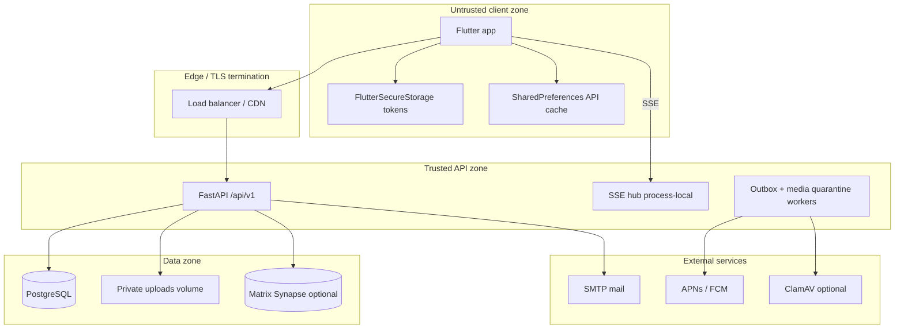

# Architecture and Trust Boundaries

Date: 2026-07-31  
Scope: PRIME monorepo (`prime-backend`, `prime-flutter`, PostgreSQL, optional Matrix Synapse)

## System context

PRIME is a habit-tracking social product. Users register, join matched groups, chat, check in daily, and receive push/in-app notifications. The backend is a FastAPI modular monolith; clients are Flutter (Android, Web, iOS scaffold).

## Trust boundaries

| # | Boundary | Trusted side | Untrusted side | Enforcement |
|---|---|---|---|---|
| TB-1 | Client ↔ API | API authZ, moderation, rate limits | Flutter/Web UI, local cache | JWT bearer, server-side membership checks |
| TB-2 | API ↔ PostgreSQL | Parameterized SQLAlchemy, session revocation | Client-supplied IDs | FK + query filters, `auth_sessions.revoked_at` |
| TB-3 | API ↔ private media | Ownership/membership on read | MXC/local URLs in messages | `media_uploads` scope registry (`app/media_scope.py`) |
| TB-4 | API ↔ Matrix | Encrypted tokens at rest | Matrix server | Fernet encryption, scoped upload recording |
| TB-5 | API ↔ push providers | Device token bound to registering user | Stolen device tokens | 409 on cross-user rebind (`notifications.py`) |
| TB-6 | Moderator plane | Step-up MFA + audit | Compromised moderator JWT | `require_moderator_step_up`, `MODERATOR_MFA_ENFORCE` in prod |
| TB-7 | Pre-publish content | Moderation pipeline | User-authored text/media refs | `moderate_text_before_publish`, media scope validation |
| TB-8 | Ops/observability | Moderator-only metrics | Public scraping | `/ops/metrics` behind step-up MFA |

## Component responsibilities

### `prime-backend`

- **Routers** (`app/routers/*`): HTTP surface under `/api/v1`; auth enforced via `app/deps.py`.
- **Sessions** (`app/sessions.py`, `auth_sessions` table): Refresh rotation, logout revoke, password-reset revoke.
- **Moderation** (`app/moderation/*`): RU/EN profanity, 18h `SOCIAL_WRITE` restriction, appeals.
- **Media pipeline** (`app/media_pipeline/*`): Quarantine → scan (noop or ClamAV) → publish local media.
- **Realtime** (`app/direct_message_events.py`): In-process SSE fan-out for DMs, notifications, group updates.
- **Workers**: Outbox push delivery + media quarantine batch processor (started in `app/main.py` lifespan).

### `prime-flutter`

- **AuthStorage**: Access/refresh tokens and cached user profile in `FlutterSecureStorage`; legacy SharedPreferences migrated on read.
- **ApiClient**: Dio client with JWT refresh interceptor; response cache (memory + disk) keyed by user scope.
- **AppGate**: Single authority for onboarding → auth → profile setup → `MainShell`; tab deep links preselect tabs only after auth resolves.
- **Route loaders**: Detail deep links fetch by ID then render screens; API 401 triggers session clear.

## Production invariants

Validated at startup when `APP_ENV=production` (`app/main.py::_validate_production_settings`):

- `ENABLE_DEV_TOOLS=false`
- `EMAIL_VERIFICATION_EXPOSE_CODE=false`
- `CORS_ALLOW_ORIGIN_REGEX` empty; `CORS_ALLOWED_ORIGINS` explicitly set
- `MODERATOR_MFA_ENFORCE=true`

## Known architectural limits

1. **SSE hub is process-local** — horizontal scale requires sticky sessions or an external pub/sub broker (see `THREAT_MODEL.md` flow F-16).
2. **Modular monolith** — no separate admin service; moderator endpoints live in the same deployable as user APIs.
3. **Client cache** — social list endpoints may persist to SharedPreferences for offline UX; tokens are not stored there post-migration.

## Related documents

- Endpoint inventory: `ENDPOINT_AND_EVENT_INVENTORY.md`
- Data classification: `DATA_FLOW_AND_CLASSIFICATION.md`
- Threat model: `THREAT_MODEL.md`
- Risk register: `RISK_REGISTER.md`
