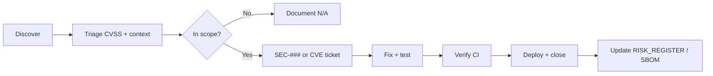

# Vulnerability Management

Date: 2026-07-31  
Program owner: Engineering (security champion TBD)

## Scope

- `prime-backend` Python dependencies and application code
- `prime-flutter` Dart/Flutter dependencies
- Container images in release pipeline
- Infrastructure outside repo (coordination with platform team)

## Sources

| Source | Frequency | Action |
|---|---|---|
| pip-audit / OSV | Every PR + weekly | Block merge on Critical |
| Bandit SAST | Every PR | Review Medium+ |
| Gitleaks | Every push | Block secrets |
| Trivy (images) | Release | Block Critical in base image |
| Dependabot/Renovate | Weekly | Triage PRs |
| External researchers | Ad hoc | See disclosure below |
| Internal `/gsd:debug` / pen test | Pre-release | REMEDIATION_PLAN items |

## Severity SLAs

| Severity | Definition | Fix SLA | Deploy SLA |
|---|---|---|---|
| **Critical** | RCE, auth bypass, mass data leak | 24h | 48h |
| **High** | IDOR, privilege escalation, secret exposure | 7d | 14d |
| **Medium** | DoS, partial info leak, missing hardening | 30d | Next release |
| **Low** | Defense in depth, informational | 90d | Backlog |

SLAs pause for holidays with Security approval; SEV-1 incidents override all work.

## Workflow



## Triage criteria (PRIME-specific)

Downgrade if exploit requires:

- Valid user session **and** moderator flag **and** no MFA (when enforce off in dev only)
- Physical device access for FlutterSecureStorage
- Already mitigated control in `CONTROL_MAPPING.md`

Upgrade if:

- Affects pre-auth endpoints (`/auth/login`, `/register`)
- Bypasses moderation or media scope
- Exposes cross-tenant data in PostgreSQL

## Disclosure policy

**Email:** security@inpr1me.ru (configure before launch)

1. Acknowledge within 3 business days  
2. Provide status every 7 days until resolved  
3. Credit researchers in release notes with permission  
4. Safe harbor for good-faith research on staging  

**Out of scope:** social engineering, physical access, third-party SMTP/Matrix without POC on PRIME config.

## Exception process

Temporary accept risk when:

- Fix blocked on upstream vendor  
- Compensating control documented (WAF rule, feature flag off)  

Record in `RISK_REGISTER.md` with expiry date and owner.

## Metrics (monthly)

| Metric | Target |
|---|---|
| Mean time to remediate Critical | < 2 days |
| Open Critical/High count | 0 at release |
| pip-audit pass rate | 100% |
| Secret scan pass rate | 100% |

## Tooling setup (CI recommendation)

```yaml
# Example jobs (not yet in repo)
- pip-audit -r prime-backend/requirements.txt --strict
- bandit -r prime-backend/app -ll
- gitleaks detect --source .
- trivy image prime-api:${TAG}
```

## Record keeping

- CVE/fix mapping → `DEPENDENCY_AND_SBOM_REPORT.md`
- Application flaws → `RISK_REGISTER.md` SEC-###
- Incident-linked vulns → `INCIDENT_RESPONSE.md` post-mortem

## Review

Quarterly program review: SLA compliance, open exceptions, SBOM drift, pen test schedule.
